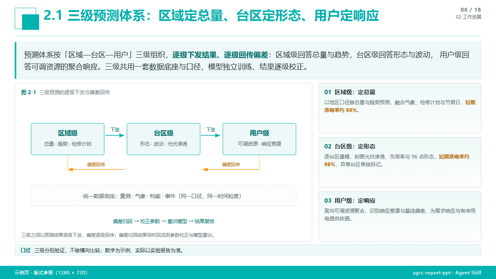

<div align="center">
  
  <h1>sgcc-report-ppt</h1>
  <p>国网 / 电网系统正式汇报 PPT 的风格合同与交付流水线</p>

  <p>
    
    
    
    
    
    
  </p>
</div>

---

**sgcc-report-ppt** 把「国网汇报 PPT」拆成可校验的三件事：**风格合同**（标题句式、左图卡 + 右栏、正式书面口吻）、**轻量流程**（开工四问 → 大纲确认 → 样张确认 → 改稿先给草稿）与**交付流水线**（HTML → PNG → PPTX，两道质检门）。写页面的人和审页面的人，看的是同一套约束。

与 `ppt-agent` 的分工：后者负责联网调研、长文压缩、多 subagent 并行生产；本技能的核心是风格约束，同时内置了可独立跑通的访谈与确认节点，以及打包脚本。两个技能可以叠加使用，也可以只装这一个——改造已有的 HTML 或 PPTX 同样适用。

## 最近更新

`2026-11-06 · v1.4`

- 新增「开工前四问」与三个确认点（G1 大纲 / G2 样张 / G3 改稿）：不再一上来就埋头排版。
- 新增离线安装包（`AGENTS.md` + `wheels/` + 安装器），内网可让 AI 客户端自己装。
- `shot.py` 与 `visual_qa.py` 共用浏览器选择逻辑：无 Chromium 时自动回退到系统 Edge。
- 新增 `deck_audit.py`：页码序列、3x 尺寸、PPTX 与 3x 图逐页 sha1 比对，一次跑完整册。
- 新增 `delete_slide.py`：PPTX 删页 + 文件前移 + 页码重排，删页不再靠手工改名。
- 新增 `patch_png_text.py`：文字烘焙进老图时的原位替换（PIL 填底 + 同字体重绘）。
- `visual_qa.py` 增加导语条留白检查："上方像空一行"从此由脚本报警，而不是靠肉眼。

## 安装

### 方式一：Agent Skills CLI（推荐，跨客户端）

```bash
npx skills add AnTi-anti/ft-ppt-agent-skills
```

常用参数（以 `npx skills --help` 为准）：

```bash
npx skills add AnTi-anti/ft-ppt-agent-skills -l      # 只预览仓库里有哪些技能
npx skills add AnTi-anti/ft-ppt-agent-skills -g -y   # 装到用户级目录，跳过确认
npx skills add AnTi-anti/ft-ppt-agent-skills --copy  # 复制文件而非软链接
```

> CLI 会自动识别 `skills/sgcc-report-ppt/SKILL.md`。npx 只装技能文件，**Python 依赖仍需单独安装**（见下）。

### 方式二：手动安装

```bash
git clone https://github.com/AnTi-anti/ft-ppt-agent-skills.git
cp -r ft-ppt-agent-skills/skills/sgcc-report-ppt ~/.claude/skills/
```

- Claude Code 个人级：`~/.claude/skills/sgcc-report-ppt`
- 项目级：`<项目>/.claude/skills/sgcc-report-ppt`

### 环境依赖

```bash
python -m pip install playwright python-pptx pillow
python -m playwright install chromium
```

安装后新开一次会话，输入 `/` 应能看到 `sgcc-report-ppt`。

### 内网 / 离线安装

内网访问不了 npm 与 GitHub，`npx skills add` 用不了。改用**离线安装包**——把它交给 AI 客户端，客户端自己就装好了。

#### 方式一：交给 AI 客户端（推荐）

1. 取得离线包 `sgcc-report-ppt-offline-v1.4.zip`（约 140 MB，由发布方提供，不在仓库内）。
2. 把包拖进客户端，或直接给出文件路径，然后说一句：

   > 按包里的 `AGENTS.md` 把 sgcc-report-ppt 装到本机，装完自己验证一遍，告诉我结果。

3. 客户端会读 `AGENTS.md`，依次完成：检查 Python → 选技能目录 → 运行 `install-offline.py` → 渲染示例页自检 → 回报结果。
4. 新开一次会话，输入 `/`，应能看到 `sgcc-report-ppt`。

#### 方式二：自己双击

解压到固定目录 → 双击 `安装.bat` → 看到 `自检结果: status: PASS` → 新开会话。

> 不要在压缩包里直接双击，Windows 的只读临时目录会导致安装失败。

#### 包里为什么能离线

| 组成 | 作用 |
|---|---|
| `AGENTS.md` / `CLAUDE.md` | 给 AI 客户端的安装步骤与红线 |
| `install-offline.py` | 安装器：`pip --no-index` 装依赖、复制技能、跑自检 |
| `wheels/` | playwright / python-pptx / pillow 及其依赖，覆盖 Python 3.9–3.14 |
| `sgcc-report-ppt/` | 技能本体 |
| `安装.bat`、`离线安装说明.md` | 给人用的入口与说明 |

浏览器也不需要下载：`shot.py` 与 `visual_qa.py` 共用 `scripts/_browser.py`，按
`SHOT_CHANNEL` → 自带 Chromium → 系统 Edge → 系统 Chrome 的顺序回退，Windows 自带 Edge 即可渲染。

#### 前提与限制

- **目标机需自备 Python 3.9–3.14**（包内是 wheel，不含解释器）；
- 客户端需能**执行命令**；纯对话客户端做不到，只能人工双击 `安装.bat`；
- 离线包为 **Windows x64**；
- 目标机需有「微软雅黑」字体，否则排版走样。

#### 不用安装器时的手工步骤

```bash
# 依赖：从包内 wheels 离线安装
python -m pip install --no-index --find-links wheels playwright python-pptx pillow

# 技能：复制目录（保证存在 sgcc-report-ppt/SKILL.md 这一层）
cp -r sgcc-report-ppt ~/.claude/skills/
```

验证：

```bash
python scripts/shot.py assets/example/slide-demo-three-tier.html demo.png 1
python scripts/visual_qa.py demo.png assets/example/slide-demo-three-tier.html
```

`status` 为 `PASS` 或 `WARN`（无 `FAIL`）即安装成功。

## 核心亮点

**先问再做，而不是猜着做**：开工前问清四件事（给谁看、几页什么结构、素材从哪来、硬性口径），出大纲让你确认、出一页样张让你看风格，再批量生产。每项都带默认值——你不答就按默认走，不会卡住。G1 大纲用 30 秒换掉整册重排，G2 样张用两页换掉二十页返工。

**风格合同，而不是风格建议**：标题必须是「编号 + 判断句」，页面只有「左图卡 + 右栏」与「整幅图 + 窄栏」两种主布局，正文字号有下限（≥10px），导语条上下留白有目标值。每一条都写成了 `visual_qa.py` 能断言的规则，不是文档里的形容词。

**双层质检，而不是只看图**：单页 QA 同时做 DOM 断言（元素矩形、字号、nowrap 溢出、卡片包含关系）与像素断言（画布尺寸、墨量覆盖、小字对比度）。前者抓"结构越界"，后者抓"看起来发虚"。

**整册一致性可计算**：页码序列、章节号、3x 尺寸、PPTX 与 PNG 的 sha1 逐页比对，一次 `deck_audit.py` 全部给出。数字对不上、忘了重渲染，都会在交付前暴露。

**以图片为交付，跨机 100% 还原**：页面在固定 1280×720 画布上以 CSS 排定，3 倍超采样成 3840×2160，再整幅写入 PPTX。目标机器没有「微软雅黑」也不会重排——代价是文字不可再编辑，换来的是零走样。

**改稿有工具链，不靠重做**：删页有 `delete_slide.py`（PPTX 删页 + 文件前移 + 页码重排），老图改字有 `patch_png_text.py`（定位暗色行带 → 填底 → 同字体重绘），组包有幂等备份与回读校验。

**口径护栏写进流程**：同一数字只允许有一个来源；单位不写 `pp`，绝对差写「个百分点」、本身是百分比写「%」；导语、卡片、图、表、报告五处必须一致。这条约束比任何排版规则都更能减少返工。

## 设计思路

一句话：**把「做一份国网汇报 PPT」拆成四类文件——合同、知识、工具、样本——再规定它们各自在什么时候被读、被跑。**

### 1. 四类文件，各管一件事

| 文件 | 放什么 | 什么时候用 | 为什么放这儿 |
|---|---|---|---|
| `SKILL.md` | 触发词、五条风格合同、两条工作路径、命令、改稿速查、红线 | 任务一开始就加载 | 全是「每次都必须遵守」的，不能等到用时才想起来 |
| `references/*.md` | 版式坐标、汇报句式、CSS 片段、17 条坑、命令手册 | 按需读，一页通常只用一两份 | 细节很多，全塞进上下文会挤掉真正要做的事 |
| `scripts/*.py` | 渲染、单页 QA、整册审计、组包、删页、图内改字 | 需要精确动作时执行 | 量像素、算哈希、改文件名，脚本比模型可靠 |
| `assets/example/` | 三张成品页 | 写第一页时对照 | 一份能直接打开的样板，比十句描述管用 |

`SKILL.md` 里那张「使用前必读」的表，本质是**索引**：告诉模型「要做 X，去读 Y」，而不是把所有知识堆在一个文件里。

### 2. 一次任务实际怎么跑

```
用户："用国网汇报风格做一份 12 页汇报"
   │
   ├─ ① 触发：description 命中「国网 / 电网汇报」→ SKILL.md 进入上下文
   │
   ├─ ② 读合同：标题须为「编号 + 判断句」；内容页只有两种布局；
   │     每页一条导语；字号 ≥10px；框内不留大块空白
   │
   ├─ ③ 访谈四问：给谁看 / 几页什么结构 / 素材从哪来 / 硬性口径
   │     每项带默认值，用户不答就按默认走
   │
   ├─ ④ 大纲 → 用户确认（G1）：章节 + 每页一句话标题，一次给全
   │
   ├─ ⑤ 样张 → 用户确认（G2）：封面 + 一个典型内容页，风格对了再批量
   │
   ├─ ⑥ 逐页写：按需读参考（坐标 / 句式 / 组件 / 坑）→ slides/slide-N.html
   │
   ├─ ⑦ 渲染 + 质检：shot.py 出图 → visual_qa.py 给 PASS / WARN / FAIL
   │     模型按「哪一项 FAIL」定点修，回到 ⑦；无 FAIL 才放行
   │
   ├─ ⑧ 组包：replace_all_slides_pptx.py 把 3× 图写入 PPTX（先备份，写完回读比对）
   │
   └─ ⑨ 复核：deck_audit.py 查页码 / 尺寸 / 哈希，确认交付物与源文件一致
```

G1、G2 是**人机之间的确认点**，其余是机器校验：前者防"做错方向"，后者防"做错细节"。

### 3. 三条设计原则

**① 把「好看」翻译成数字和断言。**
「风格统一、别太挤、字别太小」这类要求，模型每次理解都不一样。所以技能里写的是：内容区固定 `y 232–666`，左图卡 `661px` + 右栏 `525px`，正文最小 `10px`，导语条上方留白约 `18px`。有了数字，`visual_qa.py` 才能自动判定，而不是靠人盯着看。

**② 判断留给模型，精度交给脚本。**
选哪个布局、这句话怎么改、这个数字对不对——需要理解语境，交给模型；元素有没有越界、PPTX 里那张图是不是最新的、删页后页码对不对——有唯一正确答案，交给脚本。脚本不讲「大概」，所以结果可信、可重复。

**③ 每一步都留下可核对的痕迹。**
页面是 `slides/slide-N.html`，图是 `png/` 与 `png-hi/`，QA 记录是 `qa/slide-N.txt`，交付是 `deck.pptx`。谁接手、隔多久回来，都能从磁盘判断进度；`deck_audit.py` 用 sha1 回答「PPTX 里的图和源文件是不是同一张」。

### 4. 四个关键机制

**渲染：固定画布 + 3 倍超采样。**
页面写死 1280×720，`shot.py` 用 Playwright 以 `deviceScaleFactor=3` 截出 3840×2160。不用「把页面放大再截图」，因为那会连字号和留白一起放大、边缘发虚；这里只提高采样密度，布局坐标不动。截之前等 `document.fonts.ready` 与图片加载完成，避免拍到半张图。

**质检：结构 + 视觉两路。**
`visual_qa.py` 一边查 DOM——元素矩形越界、nowrap 文本溢出、卡片子元素跑出父框、标题压住页眉、导语条上方像多空一行；一边查像素——画布尺寸、墨量覆盖率、小字对比度、图片是否加载失败。输出三档：FAIL 必修，WARN 复核后可放行，PASS 直接过。

**组包：幂等 + 回读。**
`replace_all_slides_pptx.py` 假定每页正好一整幅全屏图片（本流水线的产物天然如此），按页序写入后**读回来**比对 sha1、字节数与位置，任一不符即报错；首次运行先备份 `.bak.pptx`。这样不会出现「命令成功、打开还是旧图」。

**审计：整册对齐。**
单页对了不等于整册对：`deck_audit.py` 检查 HTML 编号 1..N、每页页码 `NN / M`、3× 图尺寸、`png-hi` 是否比 HTML 旧（忘了重渲染）、PPTX 页数，以及逐页 sha1 是否与 `png-hi` 一致。

### 5. 改稿时这套设计怎么用

- **改文字**：只动 HTML → 重渲染 → QA → 组包；数字在图里的，回到绘图脚本重出图。
- **改数字**：先与实验数据 / 报告核对，`grep` 全页同名数字再改；导语、卡片、图、表必须一致。
- **删页**：`delete_slide.py` 一次完成 PPTX 删页、文件前移、页码重排；章节号等正文内容手工改。
- **老图改字**：`patch_png_text.py` 先 `--probe` 定位行带，再填底重绘，自动留 `.bak.png`。

## 工作流

```
访谈四问（受众 / 页数与结构 / 素材 / 口径）
  → 大纲：章节 + 每页一句话标题            ← G1 用户确认
  → 样张 1–2 页（封面 + 典型内容页）        ← G2 用户确认
  → 逐页 HTML（版式 A：左图卡 + 右栏 / 版式 B：整幅图 + 窄栏）
  → 1× 渲染 → visual_qa.py（FAIL 必修，WARN 复核）
  → 3× 渲染 → replace_all_slides_pptx.py（备份 + 回读校验）
  → deck_audit.py（页码 / 尺寸 / sha1 全册复核）
  → 逐页人工看 1× PNG（布局语义与信息密度，脚本查不出）
```

## 产物链

```
slides/slide-N.html
  → png/slide-N.png            # 1×，1280×720
  → png-hi/slide-N.png         # 3×，3840×2160
  → qa/slide-N.txt             # 单页 QA 记录
  → deck.pptx                  # 逐页全幅图片
  → deck.bak.pptx              # 组包前备份
```

## 效果示例

<div align="center">
  
</div>

> 示例页源码：`assets/demo/slide-demo-three-tier.html`，可直接 `python scripts/shot.py` 复现，也可作为版式起点改写。

## 快速开始

本项目以 Agent Skill 形式运行，无需独立部署。在支持 Skill 的客户端中输入需求即可触发：

> *"用国网汇报风格做一份 12 页的配网负荷预测方法汇报，标题用编号 + 判断句，重点讲三段闭环。"*

也可以直接对已有材料说：

> *"把这份 22 页 PPT 改成国网汇报风格，去掉来源标注，导语条上面不要空一行。"*

技能会先问四件事（给谁看、几页什么结构、素材从哪来、有没有硬性口径），出大纲和一页样张给你确认，
再逐页渲染、QA、组包，产物落在 `ppt-output/runs/<RUN_ID>/`。

如果你已经把情况说清楚，或者说一句「直接做，不用问」，它就跳过访谈直接开工。

## 自行修改（改 HTML 就够了）

不想交给 AI 代改、想自己动手时，**直接编辑 HTML 即可**——它就是这个项目唯一的源文件。PNG 与 PPTX 都只是它的产物，手改了也会被下次渲染覆盖。

### 改哪个文件

```
ppt-output/runs/<RUN_ID>/
├── slides/slide-1.html … slide-N.html   ← 改这里
├── images/                              ← 页内插图（HTML 里写作 ../images/xxx.png）
├── png/  png-hi/                        ← 渲染结果，不要手改
└── deck.pptx                            ← 打包结果，不要手改
```

### 改完必须重跑四步

```bash
cd ppt-output/runs/<RUN_ID>

# 1) 重渲染：1× 供检查，3× 供 PPTX
python <skill>/scripts/shot.py slides/slide-4.html png/slide-4.png 1
python <skill>/scripts/shot.py slides/slide-4.html png-hi/slide-4.png 3

# 2) 单页质检：无 FAIL 才放行
python <skill>/scripts/visual_qa.py png/slide-4.png slides/slide-4.html

# 3) 重新组包：先备份，写完回读校验
python <skill>/scripts/replace_all_slides_pptx.py deck.pptx png-hi

# 4) 全册复核：页码 / 尺寸 / 哈希
python <skill>/scripts/deck_audit.py . deck.pptx
```

`<skill>` 指技能目录，例如 `~/.claude/skills/sgcc-report-ppt`。

### 五条不要碰的约定

1. **画布固定 1280×720**：`body` / `.slide` 不要改尺寸，也不要加 `transform: scale`。
2. **改文字就只改文字**：不要把 `<b>`、`.lede`、`.card` 这类标签删掉，样式挂在它们身上。
3. **新增元素用带页面前缀的类名**（如 `.s4-note`），别用 `.k` / `.lg` / `.bk` 这类短名——旧页里有同名全局样式，会串味。
4. **字号不小于 10px**；卡片里的内容不要超出卡片边框（QA 会报 `card children out of bounds`）。
5. **文件末尾的 `!important` 覆盖块必须留在最后**，它靠「后写生效」覆盖模板样式，挪到前面就失效。

### 两个例外

- **改图里的字或曲线**：不要改 `images/*.png`，回到绘图脚本（`draw_fig*.py`）改参数重出图，再重渲染；否则下次出图又被覆盖。
- **增删页**：只改 HTML 不够。删页用 `delete_slide.py`（同时处理 PPTX 页、文件重命名、页码重排），加页需补 PPTX 页；两种情况都要重排 `<b>NN / 总页数</b>`。

> 想先看效果：跑一次 1× 渲染，打开 `png/slide-4.png`。不要直接用浏览器打开 HTML——浏览器会按窗口宽度缩放，看到的和成图不一致。

## 仓库结构

```
ft-ppt-agent-skills/
├── README.md
└── skills/
    └── sgcc-report-ppt/
        ├── SKILL.md              # 主入口：风格合同、两条路径、流水线、改稿速查、红线
        ├── references/           # 版式规范、口吻指南、CSS 组件、17 条坑与修法、命令手册
        ├── scripts/              # 渲染 / 单页 QA / 整册审计 / 组包 / 删页 / 图内改字
        └── assets/example/       # 三张成品页样例（可直接渲染对照）
```

| 脚本 | 作用 |
|---|---|
| `scripts/shot.py` | `shot.py <html> <png> <scale>`：1× 供 QA，3× 供 PPTX |
| `scripts/visual_qa.py` | 单页 QA：结构与像素十余项检查，输出 PASS / WARN / FAIL |
| `scripts/deck_audit.py` | 整册审计：编号、页码、尺寸、stale、PPTX sha1 |
| `scripts/replace_all_slides_pptx.py` | 把 `png-hi/` 写回 PPTX，备份 + 回读校验 |
| `scripts/delete_slide.py` | 删页：PPTX 删页 + 文件前移 + 页码重排 |
| `scripts/patch_png_text.py` | 图片内文字原位替换（老素材专用） |

## 客户端兼容性

| 客户端 | 安装方式 | 说明 |
|---|---|---|
| Claude Code | `npx skills add` / 手动复制 | 完整支持技能自动加载与 `/` 触发 |
| 其他实现 Agent Skills 的客户端 | `npx skills add` | 取决于客户端是否实现 SKILL.md 规范 |
| 仅支持规则文件（AGENTS.md / rules）的客户端 | 手动 | 把 `SKILL.md` 作为规则喂入，`scripts/` 照常调用 |
| 内网 / 离线环境 | 离线包 | 复制 `skills/sgcc-report-ppt` 到技能目录即可 |

> `scripts/` 全部是纯 Python（Playwright / python-pptx / Pillow），不依赖任何特定 AI 客户端；差异只在"是否自动发现技能"。

## 常见问题

| 现象 | 处理 |
|---|---|
| 中文输出报 `UnicodeEncodeError` | 加 `PYTHONIOENCODING=utf-8`（打包类脚本用 `PYTHONUTF8=1`） |
| Playwright 找不到浏览器 | `python -m playwright install chromium` |
| 组包报 `PermissionError ... .pptx` | PPTX 被 PowerPoint / WPS 占用，关闭后重跑 |
| QA 报 `nowrap text overflow` | 加宽列或去掉 `nowrap`（见 `references/pitfalls.md` #4） |
| 用户说"打开还是旧的" | 先跑 `deck_audit.py` 校验，再另存新文件名排除软件缓存 |
| 渲染字体不对 | 系统缺「微软雅黑」，安装字体后重启终端 |

## 致谢

版式与流水线的设计参考了 [ppt-agent-skills](https://github.com/sunbigfly/ppt-agent-skills) 的工程化思路：把演示文稿生产当成可校验的构建过程。两者可配合使用——`ppt-agent` 管流程，本技能管风格与交付。
